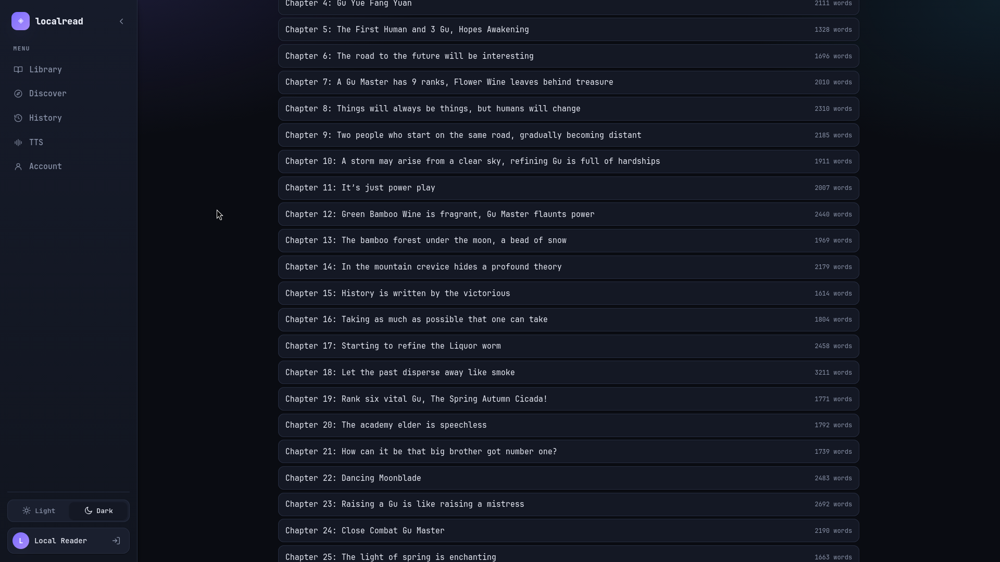
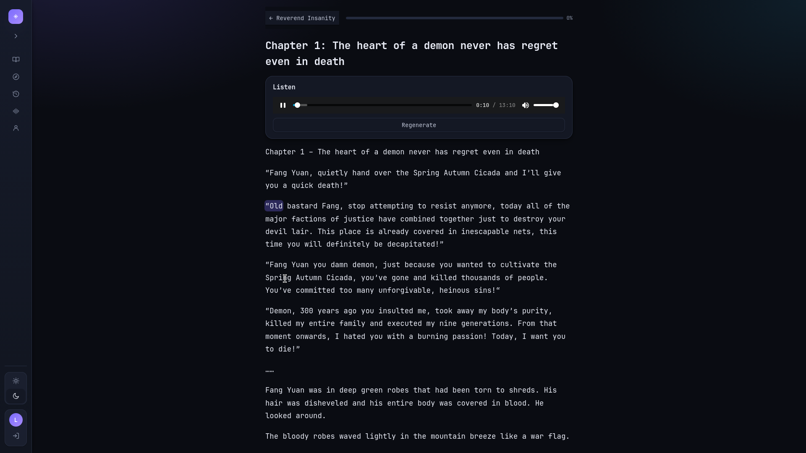

# localread

A local-first web reader: a **React** frontend and a **Go** backend that manages
your account, novels, chapters, reading progress and history, and generates
speech for chapters using a **locally running AI voice model**. You can add
several models (any OpenAI-compatible `/v1/audio/speech` server, e.g. LocalAI's
`qwen3-tts-cpp`, or Kokoro's captioned endpoint) on the **TTS** page and pick
which one to use. Models that return word timings get word-by-word highlighting
in the reader, and the page follows along by scrolling to keep the highlighted
word in view; models that only return audio just play.

```
localread/
  backend/    Go API + TTS proxy + storage (SQLite)
  frontend/   React (Vite + TypeScript) UI
```





## Backend

```sh
cd backend
go run .
```


| Var | Default | Purpose |
| --- | --- | --- |
| `LOCALREAD_ADDR` | `:8099` | Listen address |
| `LOCALREAD_DATA` | `./data` | Data/cache directory |
| `LOCALREAD_ADMIN_PASSWORD` | `localread` | Seed admin password (see note below) |
| `TTS_BASE_URL` | `http://localhost:8880` | Default model base URL (Kokoro) |
| `TTS_MODEL` | `kokoro` | Default speech model |
| `TTS_VOICE` | `af_heart` | Default voice |
| `TTS_LANG` | `a` | Language code (Kokoro lang_code) |
| `TTS_SPEED` | `1.0` | Speaking rate |

The `TTS_*` values seed the **first** model on an empty database and make it
active; after that, add and switch models on the **TTS** page (stored in
SQLite, no restart needed).

A default admin account (`admin` / `localread`) is seeded on first run. **This
default password is intentional** — it is a local, single-machine app. Override
it with `LOCALREAD_ADMIN_PASSWORD` for anything non-local.

### Import formats

- `.txt` — split into chapters on `Chapter N` / `CHAPTER I` style headings, or
  on blank-line-separated blocks when no headings are found.
- `.epub` — parsed via `container.xml` → OPF spine → XHTML, chapters taken from
  heading/section structure.

## TTS models

Open the **TTS** page to list your models and add a new one (name, base URL,
optional API key, model, voice, speed, language). You choose which model is in
use; the backend sends all speech to it.

Enter the **server root** as the base URL (e.g. `http://localhost:8080`)

When a model is saved or tested the backend probes it:

- **Kokoro** (`/dev/captioned_speech`) returns the audio **and** per-word
  timestamps, so the reader highlights words as they are spoken.
- A plain OpenAI-compatible server (LocalAI, etc.) only returns audio; the
  reader just plays it.

## Frontend

```sh
cd frontend
npm install
npm run dev
```

Dev server on `:5173`, proxies `/api` to the backend on `:8099`.

## Run with Docker

The image builds the React UI and the Go server and serves both from a single
process.

```sh
docker run --name localread --network host mf751/localread:latest
```

Then open <http://localhost:8080> (the image listens on `:8080` by default).

`--network host` shares your machine's network stack with the container, so the
speech server is reachable at the *same* address it has on your host. It expects
**Kokoro to be running at <http://localhost:8880>**, which is what the seeded
model already points at; if your Kokoro is somewhere else, edit that model's base
URL on the **TTS** page.

To keep your library across container replacements, mount the data volume:

```sh
docker run --name localread --network host \
  -v localread-data:/data \
  mf751/localread:latest
```

Host networking is **Linux-only** and ignores `-p`; the app listens on `:8080`
unless you override it (e.g. `-e LOCALREAD_ADDR=127.0.0.1:8099` to change the port
and keep it off the LAN).

A `docker-compose.yml` is included in the repo; `docker compose up -d` runs the
same command.

### Without host networking

If you do not want to give the container `--network host`, run the reader on a
normal published port, put it on a Docker network together with the speech
container, and point the model at that container's name in the UI:

```sh
docker network create localread

docker run -d --name localread \
  -p 127.0.0.1:8080:8080 \
  -v localread-data:/data \
  --network localread \
  mf751/localread:latest

# join your already-running speech container to the same network
docker network connect localread kokoro-tts
```

On the **TTS** page change the model base URL from `http://localhost:8880` to
`http://kokoro-tts:8880`. Inside a container `localhost` is the container itself,
so the host URL cannot work here: the two containers must share a network and
talk by container name. (Alternatively, publish the speech server on the host's
`0.0.0.0` and use `http://host.docker.internal:8880` with
`--add-host=host.docker.internal:host-gateway`.)

